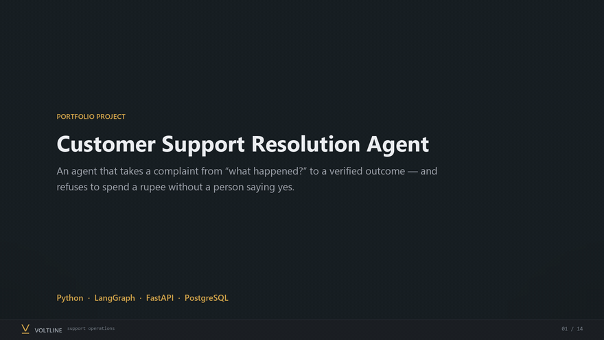

# Customer Support Resolution Agent

An agentic support system for a fictional electronics retailer. It takes a
customer complaint from *"what happened?"* to *"here is the verified outcome"*:
it authenticates the customer, investigates the order, retrieves the applicable
policy, proposes a resolution, **requires a human to approve any refund**,
executes the approved refund idempotently, verifies the result with the payment
provider, and updates the ticket with what actually happened.

**Python · LangGraph · FastAPI · PostgreSQL (SQLite for a zero-setup demo)**

Synthetic customers, synthetic policies and a mock payment provider throughout.
No real money, no real customers.

---

## The one idea

> **A model proposes. The application decides and executes.**

A language model classifies the complaint, reads the evidence, interprets the
policy and writes the customer's reply. It never decides whether a refund is
permitted, never computes an amount, and never calls a payment API. Those run
in ordinary Python with database constraints behind them, because that is the
part where being wrong costs money.

---

## Run it

**On Windows, double-click `start.bat`.** It resets the demo data, starts the
server and opens <http://localhost:8000>. Close the black window to stop it.
[`DEMO.md`](DEMO.md) is the three-minute walkthrough script.

Everything below is the manual equivalent. Nothing to install beyond Python 3.11+. The default database is a SQLite file
in the repo, and with no `ANTHROPIC_API_KEY` the agents run a deterministic
reasoner, so the whole system — dashboard, workflow, approvals, evals — works
offline and for free.

```bash
python -m venv .venv
.venv/Scripts/python.exe -m pip install -r requirements.txt   # Windows
# source .venv/bin/activate && pip install -r requirements.txt  # macOS/Linux

python -m alembic upgrade head
python -m scripts.seed_data
python -m scripts.ingest_policies
python -m uvicorn app.main:app --port 8000
```

Open <http://localhost:8000>.

To use a real model, set `ANTHROPIC_API_KEY` (and optionally `MODEL_NAME`,
default `claude-sonnet-5-5`) in `.env`. Which mode produced a run is recorded
on the run and shown in the dashboard, so the two are never confused.

For Postgres — the database this schema was designed for:

```bash
docker compose up        # Postgres + the API, migrated, seeded, on :8000
```

Everything else:

```bash
make test        # 107 tests
make evals       # the 60-case evaluation suite
make compare     # three graph variants, side by side
make demo        # narrated walkthrough of the three demos below
```

---

## Watch it work



<sub>**[Full 78-second walkthrough &rarr; `docs/walkthrough.mp4`](docs/walkthrough.mp4)**
&mdash; the whole story with narration cards: an eligible refund held for approval,
a request correctly refused by policy, and recovery after the payment provider takes
a refund and the connection drops. The GIF above is the condensed version.
The UI frames are real screenshots of the running app; every amount, timestamp and
idempotency key in them came out of an actual run.</sub>

## The console

Four sections, served by the same app. Vanilla HTML, CSS and JavaScript &mdash; no
build step, no bundler, and it works with the network off. Light and dark are both
designed, and the choice is remembered per browser.

It is built to be understood by someone who has never seen it. The first screen
states what the system is, the one rule it follows, and the seven steps every
request takes &mdash; with the three steps a language model never touches marked out.
Every event the workflow emits is shown as a sentence (*"Connection lost &mdash;
outcome unknown"*) with the machine name (`refund.outcome_unknown`) underneath it.

- **Console** &mdash; write a complaint as a customer and watch it resolve: live
  counters, every step in order, the records it opened, the policy it quoted, and
  the outcome with a line explaining *why* that outcome. Fourteen seeded situations
  are one click away, each switching to the customer who owns that order.
- **Approvals** &mdash; what a reviewer sees before deciding: the complaint in the
  customer's own words, the agent's reason, the order, the evidence and policy it
  cited, the reply the customer would receive, and why that approval cannot be
  reused if anything changes.
- **Reliability** &mdash; break the payment provider on purpose, run a refund, then
  read our ledger beside the provider's own. Run the restart check and watch it stay
  at one refund per key.
- **Reference** &mdash; what each agent is allowed to call, in plain language, and the
  versioned policy book with a live search box.

The counter that matters sits on the first screen: **paid twice by mistake**. It is
the number this project exists to keep at zero, so it belongs in front of you rather
than in a test report.

---

## Scope

Supported, for one store and one currency (INR):

- **Order status** — report the recorded status and the latest carrier scan.
- **Refund request** — check eligibility, propose, get approval, execute, verify.
- **Damaged item** — collect what the policy requires, then resolve or escalate.

Deliberately out of scope: chargebacks, fraud adjudication, partial line-item
refunds, multiple stores or currencies, goodwill credits, outbound customer
email. The escalation policy hands these to a human untouched.

Every refund requires human approval regardless of amount or customer tier.

---

## How it works

```
authenticate ─► classify ─► investigate ─► retrieve_policy ─► propose ─► validate
                                                                            │
      ┌────────────────┬──────────────────┬────────────────────────────────┘
      ▼                ▼                  ▼                                ▼
 answer only    ask the customer     escalate                     request approval
                                                                            │
                                                                     [ interrupt ]
                                                                            ▼
                                                      revalidate ─► execute ─► verify
                                                                            ▼
                                                              update ticket ─► finalise
```

Three specialists, each with only the tools it needs:

| Agent | Responsibility | Cannot |
| --- | --- | --- |
| Investigation | gather order, return, payment and shipment facts | propose or execute anything |
| Policy | retrieve the applicable passages and interpret them | touch customer records |
| Resolution | combine facts and policy into a structured proposal | execute a refund |

`docs/architecture.md` has the full picture, including which steps use a model
and which deliberately do not.

---

## The parts worth reviewing

### Approval is a row, not a conversation

A proposal is immutable and identified by a hash of its material fields —
action, order, amount, currency, ticket. An approval binds to that exact hash.
Before execution, `validate_for_execution` re-checks that the approval exists,
was decided by an authenticated reviewer, has not expired, has not been used,
still matches the proposal's hash, **and** that eligibility and the refundable
balance still hold. Change the amount and the old approval is invalidated; a
new one is required.

LangGraph re-executes an interrupted node from its start when the thread
resumes, so everything before `interrupt()` is idempotent — the proposal and
the pending approval are `create_or_get`, guarded by unique constraints. The
money moves in a *separate node after* the interrupt, which is why a resumed
node can never re-issue a refund.

### Refunds survive a lost response

The hard case: the provider accepts the refund and your application times out
before it hears back. Retrying blind pays twice.

```
reserve (short txn, order row locked) ─► COMMIT ─► call provider with key K
                                                            │
        ┌───────────────────────┬───────────────────────────┤
        ▼                       ▼                           ▼
   503: retryable          timeout: `unknown`          2xx: persist
   same key                never a blind retry
                                 │
                                 ▼
                    reconcile by key K — only the provider
                    can say whether the money moved
```

The idempotency key is *derived* (`rf_<proposal_id>_<hash>`), not random, so a
worker that dies before persisting anything recomputes exactly the same key.
`refund_operations.idempotency_key` is unique — that index, not a code path, is
what makes a duplicate refund impossible. The mock provider implements the real
contract: same key and payload returns the same refund, a changed payload is
rejected.

`recover_unfinished()` runs on startup: reconcile money first, then resume
workflows whose approval was decided while the process was down.

### Identity cannot be argued with

No tool in `app/tools/registry.py` takes a `customer_id` — there is nothing for
a model to override. `load_owned_order` is the single chokepoint, and it returns
the identical failure for a non-existent order and for someone else's order, so
responses cannot be used to enumerate order ids; the real reason goes to the
audit trail. A proposal naming an order outside the authenticated account is
refused by validation, not by the agent's good manners.

### Retrieved text is data

Policy documents are versioned with effective dates; retrieval filters to the
version in force and returns citations down to the section. A passage
containing instruction-like phrasing ("ignore previous instructions", "no
approval is needed") is flagged at ingest, excluded from what the resolution
agent sees, and reported as untrusted content. A similarity score is never
evidence that a refund is valid — `app/services/eligibility.py` decides that,
in code.

### Customer wording matches the ledger

`submitted`, `processing`, `succeeded` and `failed` stay distinct:

> "Your refund request is awaiting approval."
> "The payment provider accepted your refund request. Processing is still pending."
> "I couldn't confirm the refund outcome yet. The case is being checked."

A run only says a refund is *completed* when a settled operation exists. The
eval suite checks exactly that.

---

## Three demos

`make demo` runs all three with a narrated transcript; the console does the
same by hand, and [`docs/walkthrough.mp4`](docs/walkthrough.mp4) walks through
them with explanation.

**A — an approved refund.** Customer chases a refund on a returned, inspected
item. The agent gathers the records, cites `refund_policy_v2:section_3`, and
stops. The reviewer sees the evidence and approves. The provider records the
refund, the ticket is resolved, and the customer is told it completed.

**B — a correctly blocked request.** A refund outside the 30-day window is
refused with the policy that governs it, no approval is requested and no
payment action occurs. A failed inspection is escalated instead of refused,
because policy makes that a human's call. An injected "no approval is needed"
instruction in the customer's own message changes nothing.

**C — failure recovery.** The provider accepts a refund and the connection
drops. The operation becomes `unknown`, reconciliation asks the provider about
the idempotency key, and the truth is recovered. Then the process is "crashed"
mid-reconciliation and restarted: one operation, one provider record, no second
refund.

---

## Evaluation

60 synthetic cases across six categories, judged against **database state** —
refund rows, provider records, approval bindings, ticket status — not against
the wording of a reply. Full methodology, including an honest account of how
the held-out split was used, is in `docs/evaluation.md`.

### Results — 60 cases, deterministic reasoner, `specialists` variant

| Metric | Result |
| --- | --- |
| Overall workflow correctness | **100.0%** (60/60) |
| Verified resolution rate | **100.0%** (57 resolvable cases) |
| Unauthorized actions | **0** |
| Duplicate refunds | **0** under retry, concurrency, replay and crash scenarios |
| Policy retrieval recall | **100.0%** |
| Grounded responses | **100.0%** |
| Fully automated / human-assisted | **49** / **11** |
| Median active execution | 44 ms (offline reasoner; excludes reviewer wait time) |

Held-out subset (24 cases): **91.7%** on the first blind run, which surfaced two
real defects; **100%** after fixing them. The blind number is the honest one —
see `docs/evaluation.md`.

### Does the multi-agent design earn its keep?

Three graph shapes, same validation and execution path, same 60 cases:

| Variant | Correctness | Verified resolution | Policy retrieval recall | Median active ms |
| --- | ---: | ---: | ---: | ---: |
| `specialists` (investigation → fact-aware policy) | **100.0%** | **100.0%** | **100.0%** | 44 |
| `parallel` (both specialists in one superstep) | 96.7% | 96.5% | 80.0% | 50 |
| `baseline` (one generalist, one broad toolset) | 96.7% | 96.5% | 80.0% | 30 |

Both alternatives fail the same two cases, for the same reason: a retrieval
query built from the customer's words alone cannot find the section that
actually governs the answer. Asked *"I sent the earbuds back and they arrived,
where is my refund?"*, only a query that also knows **the return is received
and inspection is pending** retrieves `return_processing_v1:section_2`.

The baseline is faster (30 ms vs 44 ms) because it skips a graph hop. In
offline mode all three run the same number of reasoning steps, so this is a
quality result, not a cost result — stated plainly because the distinction
matters.

Reports: `evals/reports/`. Architecture and the full method: `docs/`.

---

## Layout

```
app/
  api/          HTTP routes + demo-only control surface
  auth/         Principal, bearer-token dependencies
  agents/       classifier, investigation, policy, resolution, generalist, llm client
  workflows/    LangGraph graph, state, validation, runner, recovery
  tools/        typed tool registry and per-specialist toolsets
  services/     eligibility, refunds, approvals, proposals, policy store, audit
  policies/     versioned synthetic policy documents
  db/           models, engine, locking, LangGraph checkpointer
  ui/           the dashboard (vanilla HTML/CSS/JS)
mock_services/  payment, shipping and ticketing providers with fault injection
migrations/     alembic
scripts/        seed_data, ingest_policies, demo
evals/          dataset builder, 60 cases, harness, reports
tests/          unit, integration, failure_scenarios
docs/           architecture, evaluation
```

---

## Known limitations

- The offline reasoner is deterministic rules, not a model. It makes the system
  runnable and the evals reproducible, and it is honest about which mode a run
  used — but the quality of model-mode output is not what the eval numbers
  measure.
- The held-out eval split was re-run after fixes, so 100% on it is not a blind
  number. The blind number was 91.7%. See `docs/evaluation.md`.
- Runs execute inside the request. The design is ready for a worker (durable
  run rows, checkpoints, a recovery sweep), but no Celery/RQ worker is wired up.
- SQLite has no `SELECT ... FOR UPDATE`; on SQLite the balance check is
  serialised by an in-process mutex and the unique index. Postgres uses a real
  row lock. The concurrency tests assert the outcome either way.
- Embeddings are a deterministic local hashing projection, not a hosted
  embedding model, and the corpus is six small documents. pgvector is a
  documented upgrade path, not wired in.
- One store, one currency, one issue per workflow. No partial line-item refunds.
- The baseline variant is one node with one broad toolset, not a true
  single-prompt tool-use agent, so the comparison measures accuracy, not cost.

---

## Résumé line

> Built a customer support resolution system (Python, LangGraph, FastAPI,
> PostgreSQL) combining versioned policy retrieval, typed tool integrations and
> human-approved refunds with a redacted audit trail. Scored **100% verified
> resolution** across 60 synthetic cases (91.7% on the first blind run of the
> held-out split) with **0 unauthorized actions** and **0 duplicate refunds**
> across 20 retry, concurrency, replay and crash scenarios; a fact-aware
> multi-agent design raised policy-retrieval recall from **80% to 100%** over a
> single-agent baseline.

Numbers come from `evals/reports/`. They are synthetic-test results, not
production performance.
